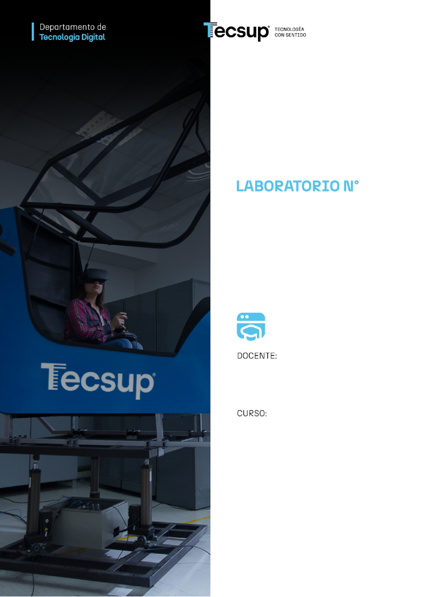

Desarrollo de Aplicaciones Web: 4 C24 Sección A B

Clases, atributos y métodos

`                                `**11**

**Desarrollo de aplicaciones Web:** Creación de Microservicios.

Coello Palomino, Ricardo

Desarrollo de aplicaciones Web

5 - C24 - Sección A B 

**DESARROLLO DE APLICACIONES WEB AVANZADO: Creación de Microservicios.**

1. **Capacidades**

   Diseñar y crear microservicios básicos.

1. **Seguridad**
- En este laboratorio está prohibida la manipulación del hardware, conexiones eléctricas o de red. Así como la ingesta de alimentos y bebidas. 
- Ubicar maletines y/o mochilas en lugar destinado para tal fin.
- Dejar la mesa de trabajo y la silla utilizada limpias y ordenadas.

1. **Fundamento teórico**
- Revise el material de la semana correspondiente antes del desarrollo del laboratorio.

1. **Normas empleadas**
- *No aplica*

1. **Recursos**
- En este laboratorio, cada estudiante trabajará con una computadora con Windows 10.
- La instalación del software requerido se realizará en el equipo virtual.

1. **Metodología para el desarrollo de la tarea**
- El desarrollo del laboratorio es individual

1. **Procedimiento**

**Microservicios**

Crear las siguientes bases de datos:

CREATE DATABASE bd\_categoria

CREATE DATABASE bd\_producto

CREATE DATABASE bd\_cliente

CREATE DATABASE bd\_pedido

1\. Crear la carpeta microservicios.

2\. Crear los siguientes proyectos Maven(https://start.spring.io/):

**Categoría**

Project: Maven

Languaje: Java

Spring Boot: 4.1.0

Project Metadata:

`	`Group: com.tecsup

`	`Artifact: categoría-service

`	`Package name: com.tecsup

Packaging: jar

Configuration: Properties

Java: 25

Dependencias:

Spring Web

Spring Data JPA

Spring Boot DevTools

MySQL Driver

**Producto**

Project: Maven

Languaje: Java

Spring Boot: 4.1.0

Project Metadata:

`	`Group: com.tecsup

`	`Artifact: producto-service

`	`Package name: com.tecsup

Packaging: jar

Configuration: Properties

Java: 25

Dependencias:

Spring Web

Spring Data JPA

Spring Boot DevTools

MySQL Driver

**Cliente**

Project: Maven

Languaje: Java

Spring Boot: 4.1.0

Project Metadata:

`	`Group: com.tecsup

`	`Artifact: cliente-service

`	`Package name: com.tecsup

Packaging: jar

Configuration: Properties

Java: 25

Dependencias:

Spring Web

Spring Data JPA

Spring Boot DevTools

MySQL Driver

**Pedido**

Project: Maven

Languaje: Java

Spring Boot: 4.1.0

Project Metadata:

`	`Group: com.tecsup

`	`Artifact: pedido-service

`	`Package name: com.tecsup

Packaging: jar

Configuration: Properties

Java: 25

Dependencias:

Spring Web

Spring Data JPA

Spring Boot DevTools

MySQL Driver

3\. Abrir la carpeta microservicios en el programa Intellij.

4\. Crear la siguiente estructura de carpetas a cada proyecto.

- Controller
- Model
- Dto
- Exception
- Repository
- Services

5\. A cada proyecto realizar cambios en application.properties

**Categoría**

spring.datasource.url=jdbc:mysql://localhost:3306/bd\_categoria\
spring.datasource.username=root\
spring.datasource.password=\
\
spring.jpa.hibernate.ddl-auto=update\
spring.jpa.show-sql=true\
spring.jpa.database-platform=org.hibernate.dialect.MySQLDialect\
\
server.port=8082

**Cliente**

spring.datasource.url=jdbc:mysql://localhost:3306/bd\_cliente\
spring.datasource.username=root\
spring.datasource.password=\
\
spring.jpa.hibernate.ddl-auto=update\
spring.jpa.show-sql=true\
spring.jpa.database-platform=org.hibernate.dialect.MySQLDialect\
\
server.port=8081

**Pedido**

spring.datasource.url=jdbc:mysql://localhost:3306/bd\_pedido\
spring.datasource.username=root\
spring.datasource.password=\
\
spring.jpa.hibernate.ddl-auto=update\
spring.jpa.show-sql=true\
spring.jpa.database-platform=org.hibernate.dialect.MySQLDialect\
\
server.port=8084

**Producto**

spring.datasource.url=jdbc:mysql://localhost:3306/bd\_producto\
spring.datasource.username=root\
spring.datasource.password=\
\
spring.jpa.hibernate.ddl-auto=update\
spring.jpa.show-sql=true\
spring.jpa.database-platform=org.hibernate.dialect.MySQLDialect\
\
server.port=8083

**6. Realizar los siguientes códigos en el servicio categoria**

Añadir la dependencia:

<dependency>\
`    `<groupId>org.springframework.boot</groupId>\
`    `<artifactId>spring-boot-starter-validation</artifactId>\
</dependency>

**Clase Categoria**

package com.tecsup.model;\
\
\
import jakarta.persistence.Entity;\
import jakarta.persistence.GeneratedValue;\
import jakarta.persistence.GenerationType;\
import jakarta.persistence.Id;\
\
@Entity\
public class Categoria {\
\
`    `@Id\
`    `@GeneratedValue(strategy = GenerationType.*IDENTITY*)\
`    `private Long id;\
\
`    `private String nombre;\
`    `private String estado;\
\
`    `public Categoria() {\
`    `}\
\
`    `public Categoria(Long id, String nombre, String estado) {\
`        `this.id = id;\
`        `this.nombre = nombre;\
`        `this.estado = estado;\
`    `}\
\
`    `public Long getId() {\
`        `return id;\
`    `}\
\
`    `public void setId(Long id) {\
`        `this.id = id;\
`    `}\
\
`    `public String getNombre() {\
`        `return nombre;\
`    `}\
\
`    `public void setNombre(String nombre) {\
`        `this.nombre = nombre;\
`    `}\
\
`    `public String getEstado() {\
`        `return estado;\
`    `}\
\
`    `public void setEstado(String estado) {\
`        `this.estado = estado;\
`    `}\
}

**Clase CategoriaDTO**

package com.tecsup.dto;\
\
import jakarta.validation.constraints.\*;\
\
public class CategoriaDTO {\
\
`    `@NotBlank(message = "El nombre es obligatorio")\
`    `private String nombre;\
\
`    `@NotBlank(message = "El estado es obligatorio")\
`    `private String estado;\
\
`    `public String getEstado() {\
`        `return estado;\
`    `}\
\
`    `public void setEstado(String estado) {\
`        `this.estado = estado;\
`    `}\
\
`    `public String getNombre() {\
`        `return nombre;\
`    `}\
\
`    `public void setNombre(String nombre) {\
`        `this.nombre = nombre;\
`    `}\
}

**Clase GlobalExceptionHandler**

package com.tecsup.exception;\
\
import org.springframework.http.ResponseEntity;\
import org.springframework.web.bind.MethodArgumentNotValidException;\
import org.springframework.web.bind.annotation.\*;\
\
import org.springframework.http.HttpStatus;\
\
import java.util.HashMap;\
import java.util.Map;\
\
@RestControllerAdvice\
public class GlobalExceptionHandler {\
\
\
`    `@ExceptionHandler(MethodArgumentNotValidException.class)\
`    `public ResponseEntity<Map<String, String>> manejarErrores(\
`            `MethodArgumentNotValidException ex) {\
\
\
`        `Map<String, String> errores = new HashMap<>();\
\
`        `ex.getBindingResult()\
.getFieldErrors()\
.forEach(error -> {\
\
`                    `errores.put(\
`                            `error.getField(),\
`                            `error.getDefaultMessage()\
`                    `);\
\
`                `});\
\
\
`        `return ResponseEntity.*badRequest*()\
.body(errores);\
`    `}\
\
`    `@ExceptionHandler(ResourceNotFoundException.class)\
`    `public ResponseEntity<Map<String,String>> manejarNoEncontrado(\
`            `ResourceNotFoundException ex){\
\
\
`        `Map<String,String> error = new HashMap<>();\
\
`        `error.put("mensaje", ex.getMessage());\
`        `error.put("codigo","404");\
\
\
`        `return ResponseEntity\
.*status*(HttpStatus.*NOT\_FOUND*)\
.body(error);\
`    `}\
}

**Clase ResourceNotFoundException**

package com.tecsup.exception;\
\
public class ResourceNotFoundException extends RuntimeException {\
\
`    `public ResourceNotFoundException(String mensaje){\
`            `super(mensaje);\
`        `}\
`    `}

**Interface Repository**

package com.tecsup.repository;\
\
import com.tecsup.model.Categoria;\
import org.springframework.data.jpa.repository.JpaRepository;\
\
public interface CategoriaRepository extends JpaRepository<Categoria,Long> {\
}

**Clase CategoriaService**

package com.tecsup.services;\
\
import com.tecsup.exception.ResourceNotFoundException;\
import com.tecsup.model.Categoria;\
import com.tecsup.repository.CategoriaRepository;\
import org.springframework.beans.factory.annotation.Autowired;\
import org.springframework.stereotype.Service;\
\
import java.util.List;\
\
@Service\
public class CategoriaService {\
\
`    `@Autowired\
`    `private CategoriaRepository repo;\
\
`    `public List<Categoria> listar() {\
`        `return repo.findAll();\
`    `}\
\
`    `public Categoria guardar(Categoria p) {\
`        `return repo.save(p);\
`    `}\
\
`    `public Categoria obtener(Long id) {\
`        `return repo.findById(id).orElseThrow(\
`                `() -> new ResourceNotFoundException(\
`                        `"Categoria no encontrada con id: " + id\
`                `));\
`    `}\
\
`    `public void eliminar(Long id) {\
`        `Categoria categoria =\
`                `repo.findById(id)\
.orElseThrow(\
`                                `() -> new ResourceNotFoundException(\
`                                        `"Categoria no encontrada con id: " + id)\
`                        `);\
`        `repo.delete(categoria);\
`    `}\
}

**Clase CategoriaController**

package com.tecsup.controller;\
\
import com.tecsup.dto.CategoriaDTO;\
import com.tecsup.model.Categoria;\
import com.tecsup.services.CategoriaService;\
import jakarta.validation.Valid;\
import org.springframework.beans.factory.annotation.Autowired;\
import org.springframework.http.ResponseEntity;\
import org.springframework.web.bind.annotation.\*;\
\
import java.util.List;\
\
@RestController\
@RequestMapping("/api/categorias")\
public class CategoriaController {\
\
`    `@Autowired\
`    `private CategoriaService service;\
\
`    `@GetMapping\
`    `public ResponseEntity<List<Categoria>> listar() {\
`        `return ResponseEntity.*ok*(service.listar());\
`    `}\
\
`    `@PostMapping\
`    `public ResponseEntity<?> guardar(@Valid @RequestBody CategoriaDTO dto) {\
\
`        `Categoria c = new Categoria();\
`        `c.setNombre(dto.getNombre());\
`        `c.setEstado(dto.getEstado());\
\
`        `Categoria guardado = service.guardar(c);\
\
`        `return ResponseEntity.*status*(201).body(guardado);\
`    `}\
\
`    `@GetMapping("/{id}")\
`    `public ResponseEntity<?> obtener(@PathVariable Long id) {\
`        `Categoria c = service.obtener(id);\
`        `if (c == null) {\
`            `return ResponseEntity.*notFound*().build();\
`        `}\
`        `return ResponseEntity.*ok*(c);\
`    `}\
\
`    `@PutMapping("/{id}")\
`    `public ResponseEntity<?> actualizar(@PathVariable Long id,\
`                                        `@Valid @RequestBody CategoriaDTO dto)\
`    `{\
`        `Categoria existente = service.obtener(id);\
`        `if (existente == null) {\
`            `return ResponseEntity.*notFound*().build();\
`        `}\
`        `existente.setNombre(dto.getNombre());\
`        `existente.setEstado(dto.getEstado());\
`        `return ResponseEntity.*ok*(service.guardar(existente));\
`    `}\
\
`    `@DeleteMapping("/{id}")\
`    `public ResponseEntity<?> eliminar(@PathVariable Long id) {\
`        `Categoria c = service.obtener(id);\
`        `if (c == null) {\
`            `return ResponseEntity.*status*(404).body("No existe");\
`        `}\
`        `service.eliminar(id);\
`        `return ResponseEntity.*ok*("Eliminado correctamente");\
`    `}\
}

**Nota:** 

- Realizar pruebas en Postman.
- Realizar los códigos de los siguientes servicios.

**7. Realizar los siguientes códigos en el servicio pedido**

**Clase Pedido**

package com.tecsup.model;\
\
import jakarta.persistence.\*;\
import java.time.LocalDate;\
import java.util.List;\
\
@Entity\
public class Pedido {\
\
`    `@Id\
`    `@GeneratedValue(strategy = GenerationType.*IDENTITY*)\
`    `private Long idPedido;\
\
`    `private LocalDate fecha;\
\
`    `private Long idCliente;\
\
`    `private Double total;\
\
`    `@OneToMany(mappedBy = "pedido", cascade = CascadeType.*ALL*)\
`    `private List<DetallePedido> detalles;\
\
`    `*// getters y setters*\
\
\
`    `public Long getIdPedido() {\
`        `return idPedido;\
`    `}\
\
`    `public void setIdPedido(Long idPedido) {\
`        `this.idPedido = idPedido;\
`    `}\
\
`    `public LocalDate getFecha() {\
`        `return fecha;\
`    `}\
\
`    `public void setFecha(LocalDate fecha) {\
`        `this.fecha = fecha;\
`    `}\
\
`    `public Long getIdCliente() {\
`        `return idCliente;\
`    `}\
\
`    `public void setIdCliente(Long idCliente) {\
`        `this.idCliente = idCliente;\
`    `}\
\
`    `public Double getTotal() {\
`        `return total;\
`    `}\
\
`    `public void setTotal(Double total) {\
`        `this.total = total;\
`    `}\
\
`    `public List<DetallePedido> getDetalles() {\
`        `return detalles;\
`    `}\
\
`    `public void setDetalles(List<DetallePedido> detalles) {\
`        `this.detalles = detalles;\
`    `}\
}

**Clase DetallePedido**

package com.tecsup.model;\
\
import jakarta.persistence.\*;\
\
@Entity\
public class DetallePedido {\
\
`    `@Id\
`    `@GeneratedValue(strategy = GenerationType.*IDENTITY*)\
`    `private Long idDetalle;\
\
`    `private Long idProducto;\
\
`    `private Integer cantidad;\
\
`    `private Double precio;\
\
`    `@ManyToOne\
`    `@JoinColumn(name = "id\_pedido")\
`    `private Pedido pedido;\
\
`    `*// getters y setters*\
\
\
`    `public Long getIdDetalle() {\
`        `return idDetalle;\
`    `}\
\
`    `public void setIdDetalle(Long idDetalle) {\
`        `this.idDetalle = idDetalle;\
`    `}\
\
`    `public Long getIdProducto() {\
`        `return idProducto;\
`    `}\
\
`    `public void setIdProducto(Long idProducto) {\
`        `this.idProducto = idProducto;\
`    `}\
\
`    `public Integer getCantidad() {\
`        `return cantidad;\
`    `}\
\
`    `public void setCantidad(Integer cantidad) {\
`        `this.cantidad = cantidad;\
`    `}\
\
`    `public Double getPrecio() {\
`        `return precio;\
`    `}\
\
`    `public void setPrecio(Double precio) {\
`        `this.precio = precio;\
`    `}\
\
`    `public Pedido getPedido() {\
`        `return pedido;\
`    `}\
\
`    `public void setPedido(Pedido pedido) {\
`        `this.pedido = pedido;\
`    `}\
}

**interface PedidoRepository**

package com.tecsup.repository;\
\
import com.tecsup.model.Pedido;\
import org.springframework.data.jpa.repository.JpaRepository;\
import org.springframework.stereotype.Repository;\
\
@Repository\
public interface PedidoRepository extends JpaRepository<Pedido, Long> {\
}

**Clase PedidoService**

package com.tecsup.services;\
\
import com.tecsup.model.DetallePedido;\
import com.tecsup.model.Pedido;\
import com.tecsup.repository.PedidoRepository;\
import org.springframework.beans.factory.annotation.Autowired;\
import org.springframework.stereotype.Service;\
\
import java.util.List;\
import java.util.Optional;\
\
@Service\
public class PedidoService {\
\
`    `@Autowired\
`    `private PedidoRepository repository;\
\
`    `public List<Pedido> listar() {\
`        `return repository.findAll();\
`    `}\
\
`    `public Optional<Pedido> buscarPorId(Long id) {\
`        `return repository.findById(id);\
`    `}\
\
`    `public Pedido guardar(Pedido pedido) {\
\
`        `if (pedido.getDetalles() != null) {\
`            `for (DetallePedido detalle : pedido.getDetalles()) {\
`                `detalle.setPedido(pedido);\
`            `}\
`        `}\
\
`        `return repository.save(pedido);\
`    `}\
\
`    `public Pedido actualizar(Long id, Pedido pedido) {\
\
`        `Pedido pedidoExistente = repository.findById(id)\
.orElseThrow(() ->\
`                        `new RuntimeException("Pedido no encontrado"));\
\
`        `pedidoExistente.setFecha(pedido.getFecha());\
`        `pedidoExistente.setIdCliente(pedido.getIdCliente());\
`        `pedidoExistente.setTotal(pedido.getTotal());\
\
`        `return repository.save(pedidoExistente);\
`    `}\
\
`    `public void eliminar(Long id) {\
`        `repository.deleteById(id);\
`    `}\
\
}

**Clase PedidoController**

package com.tecsup.controller;\
\
import com.tecsup.model.Pedido;\
import com.tecsup.services.PedidoService;\
import org.springframework.beans.factory.annotation.Autowired;\
import org.springframework.web.bind.annotation.\*;\
\
import java.util.List;\
\
@RestController\
@RequestMapping("/api/pedidos")\
public class PedidoController {\
\
`    `@Autowired\
`    `private PedidoService service;\
\
`    `@GetMapping\
`    `public List<Pedido> listar() {\
`        `return service.listar();\
`    `}\
\
`    `@GetMapping("/{id}")\
`    `public Pedido buscar(@PathVariable Long id) {\
\
`        `return service.buscarPorId(id)\
.orElseThrow(() ->\
`                        `new RuntimeException("Pedido no encontrado"));\
`    `}\
\
`    `@PostMapping\
`    `public Pedido guardar(@RequestBody Pedido pedido) {\
`        `return service.guardar(pedido);\
`    `}\
\
`    `@PutMapping("/{id}")\
`    `public Pedido actualizar(\
`            `@PathVariable Long id,\
`            `@RequestBody Pedido pedido) {\
\
`        `return service.actualizar(id, pedido);\
`    `}\
\
`    `@DeleteMapping("/{id}")\
`    `public String eliminar(@PathVariable Long id) {\
\
`        `service.eliminar(id);\
\
`        `return "Pedido eliminado correctamente";\
`    `}\
}

**8. Realizar pruebas en Postman**

**Servicio Cliente**

{

`  `"nombre": "Juan",

`  `"apellidos": "Pérez Gómez",

`  `"direccion": "Av. Javier Prado 123, Lima",

`  `"telefono": "987654321",

`  `"nroDni": "12345678",

`  `"estado": "ACTIVO"

}

{

`  `"nombre": "María",

`  `"apellidos": "Ramírez Torres",

`  `"direccion": "Calle Los Olivos 456",

`  `"telefono": "912345678",

`  `"nroDni": "87654321",

`  `"estado": "ACTIVO"

}

**Servicio Categoría**

{

`  `"nombre": "Laptops",

`  `"estado": "ACTIVO"

}

{

`  `"nombre": "Accesorios",

`  `"estado": "ACTIVO"

}

{

`  `"nombre": "Impresoras",

`  `"estado": "ACTIVO"

}

**Servicio Producto**

{

`  `"nombre": "Laptop Lenovo ThinkPad",

`  `"precio": 3500.00,

`  `"stock": 15,

`  `"categoriaId": 1

}

{

`  `"nombre": "Mouse Logitech M185",

`  `"precio": 89.90,

`  `"stock": 50,

`  `"categoriaId": 2

}

{

`  `"nombre": "Teclado Mecánico Redragon",

`  `"precio": 199.99,

`  `"stock": 25,

`  `"categoriaId": 2

}

**Servicio Pedido**

{

`  `"fecha": "2026-06-10",

`  `"idCliente": 1,

`  `"total": 3679.80,

`  `"detalles": [

`    `{

`      `"idProducto": 1,

`      `"cantidad": 1,

`      `"precio": 3500.00

`    `},

`    `{

`      `"idProducto": 2,

`      `"cantidad": 2,

`      `"precio": 89.90

`    `}

`  `]

}

{

`  `"fecha": "2026-06-10",

`  `"idCliente": 2,

`  `"total": 579.78,

`  `"detalles": [

`    `{

`      `"idProducto": 2,

`      `"cantidad": 2,

`      `"precio": 89.90

`    `},

`    `{

`      `"idProducto": 3,

`      `"cantidad": 2,

`      `"precio": 199.99

`    `}

`  `]

}

**Uso de YAML**

**CATEGORIA-SERVICE**

1\. Click derecho en resources / new / Files, escribir el nombre “application.yml”

server:\
`  `port: 8082\
\
spring:\
`  `application:\
`    `name: categoria-service\
\
`  `datasource:\
`    `url: jdbc:mysql://localhost:3306/bd\_categoria\
`    `username: root\
`    `password:\
\
`  `jpa:\
`    `hibernate:\
`      `ddl-auto: update\
`    `show-sql: true

`    `database-platform: org.hibernate.dialect.MySQLDialect

Nota: Eliminar el archivo application.properties y realizar los mismos paso para los demás servicios.

**Agregar perfiles dev y prod**

2\. Añadir las siguientes Base de Datos

CREATE DATABASE bd\_categoria\_dev;

CREATE DATABASE bd\_producto\_dev;

CREATE DATABASE bd\_cliente\_dev;

CREATE DATABASE bd\_pedido\_dev;

3\. En el proyecto categoría-service, añadir los siguientes archivos en la carpeta resources.

Application.yml

Application-dev.yml

Application-prod.yml

**Application.yml**

spring:\
`  `profiles:\
`    `active: dev

**Application-dev.yml**

server:\
`  `port: 8082\
\
spring:\
`  `datasource:\
`    `url: jdbc:mysql://localhost:3306/bd\_categoria\_dev\
`    `username: root\
`    `password:

jpa:\
`    `hibernate:\
`      `ddl-auto: update\
`    `show-sql: true

empresa:\
`  `ambiente: desarrollo

**Application-prod.yml**

server:\
`  `port: 9092\
\
spring:\
`  `datasource:\
`    `url: jdbc:mysql://servidor/bd\_categoria\
`    `username: root\
`    `password:

jpa:\
`    `hibernate:\
`      `ddl-auto: update\
`    `show-sql: true

empresa:\
`  `ambiente: produccion

4\. Ejecutar el archivo principal de la categoría-service y realice pruebas en Postman (GET, POST).

**Actividad**

**Laboratorio: Desarrollo de un Sistema de Gestión de Citas utilizando Arquitectura de Microservicios**

**Objetivo**

Diseñar e implementar un sistema de gestión de citas aplicando el patrón de **Arquitectura de Microservicios con Spring Boot**, permitiendo la comunicación entre servicios independientes para administrar pacientes, médicos y citas.

**Situación Problemática**

La clínica **"Salud Integral"** requiere digitalizar el proceso de programación de citas médicas.

Actualmente la información se encuentra dispersa y no existe una integración adecuada entre las áreas de pacientes, médicos y programación de citas.

Para resolver esta problemática se solicita implementar una solución basada en microservicios que permita gestionar de forma independiente cada proceso del negocio.

**Requerimientos Funcionales**

El sistema estará compuesto por los siguientes microservicios:

**Microservicio Paciente**

Responsable de administrar la información de los pacientes.
### **Funcionalidades**
- Registrar paciente. 
- Listar pacientes. 
- Buscar paciente por ID. 
- Actualizar paciente. 
- Eliminar paciente. 
## **Microservicio Médico**
Responsable de administrar la información de los médicos.
### **Funcionalidades**
- Registrar médico. 
- Listar médicos. 
- Buscar médico por ID. 
- Actualizar médico. 
- Eliminar médico. 

**Microservicio Citas**

Responsable de gestionar las citas médicas.
### **Funcionalidades**
- Registrar cita. 
- Listar citas. 
- Buscar cita por ID. 
- Actualizar estado de cita. 
- Cancelar cita. 

Estados posibles:

- PROGRAMADA 
- CONFIRMADA 
- ATENDIDA 
- CANCELADA

**Tabla: paciente**

CREATE TABLE paciente (

`    `id\_paciente INT AUTO\_INCREMENT PRIMARY KEY,

`    `dni VARCHAR(8) UNIQUE,

`    `nombres VARCHAR(100) NOT NULL,

`    `apellidos VARCHAR(100) NOT NULL,

`    `fecha\_nacimiento DATE,

`    `sexo CHAR(1),

`    `telefono VARCHAR(15),

`    `direccion VARCHAR(200),

`    `correo VARCHAR(100),

`    `estado CHAR(1) DEFAULT 'A'

);

**Tabla: especialidad**

CREATE TABLE especialidad (

`    `id\_especialidad INT AUTO\_INCREMENT PRIMARY KEY,

`    `nombre VARCHAR(100) NOT NULL,

`    `descripcion VARCHAR(200),

`    `estado CHAR(1) DEFAULT 'A'

);

**Tabla: medico**

CREATE TABLE medico (

`    `id\_medico INT AUTO\_INCREMENT PRIMARY KEY,

`    `cmp VARCHAR(20) UNIQUE,

`    `nombres VARCHAR(100) NOT NULL,

`    `apellidos VARCHAR(100) NOT NULL,

`    `telefono VARCHAR(15),

`    `correo VARCHAR(100),

`    `id\_especialidad INT NOT NULL,

`    `estado CHAR(1) DEFAULT 'A',

`    `FOREIGN KEY (id\_especialidad)

`        `REFERENCES especialidad(id\_especialidad)

);

**Tabla: horario\_medico**

CREATE TABLE horario\_medico (

`    `id\_horario INT AUTO\_INCREMENT PRIMARY KEY,

`    `id\_medico INT NOT NULL,

`    `dia\_semana VARCHAR(15),

`    `hora\_inicio TIME,

`    `hora\_fin TIME,

`    `FOREIGN KEY (id\_medico)

`        `REFERENCES medico(id\_medico)

);

**Tabla: cita**

CREATE TABLE cita (

`    `id\_cita INT AUTO\_INCREMENT PRIMARY KEY,

`    `fecha DATE NOT NULL,

`    `hora TIME NOT NULL,

`    `id\_paciente INT NOT NULL,

`    `id\_medico INT NOT NULL,

`    `motivo VARCHAR(300),

`    `estado VARCHAR(20) DEFAULT 'PROGRAMADA',

`    `FOREIGN KEY (id\_paciente)

`        `REFERENCES paciente(id\_paciente),

`    `FOREIGN KEY (id\_medico)

`        `REFERENCES medico(id\_medico)

);

**Tabla: atención**

Esta tabla registra el resultado de la cita.

CREATE TABLE atencion (

`    `id\_atencion INT AUTO\_INCREMENT PRIMARY KEY,

`    `id\_cita INT UNIQUE,

`    `diagnostico TEXT,

`    `tratamiento TEXT,

`    `observaciones TEXT,

`    `fecha\_registro DATETIME DEFAULT CURRENT\_TIMESTAMP,

`    `FOREIGN KEY (id\_cita)

`        `REFERENCES cita(id\_cita)

);

**Conclusiones:**

Indicar 5 conclusiones que llegó después de los temas tratados de manera práctica en este laboratorio.

|||
| :- | :- |
|||
|||
|||
|||
|||

